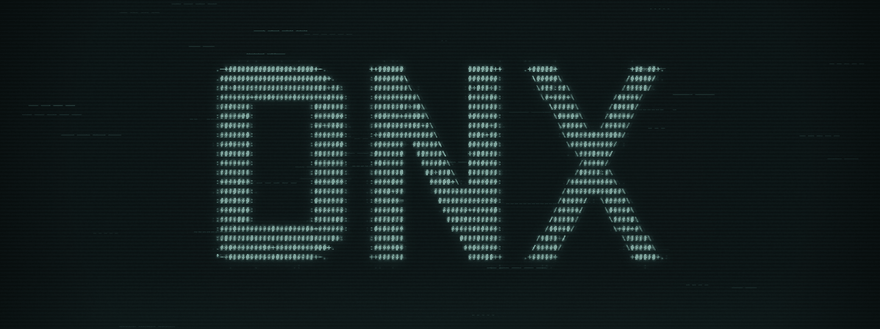
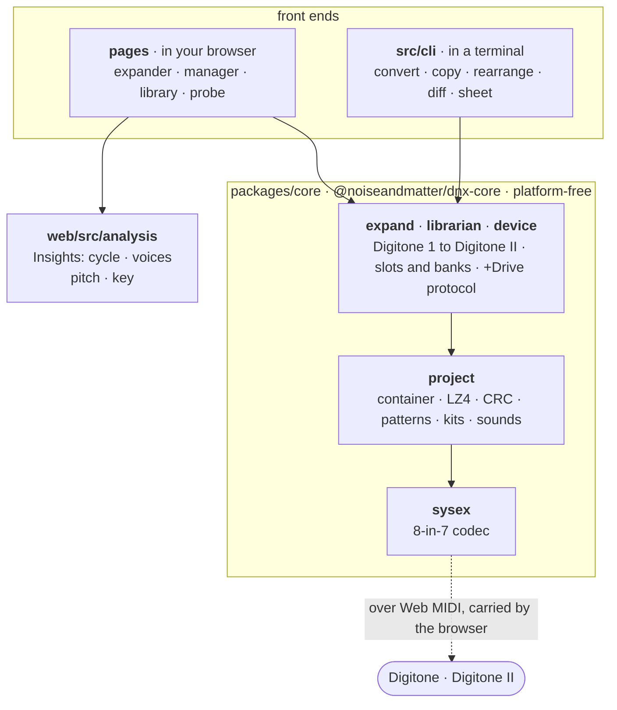

# DNX

**Tools for Elektron Digitone and Digitone II projects, in your browser.**
**→ [noiseandmatter.github.io/DNX](https://noiseandmatter.github.io/DNX/)**

Expand a Digitone 1 sketch onto the sixteen tracks of a Digitone II. Move patterns between slots,
banks and projects. Browse and rename presets on the +Drive. Back up the whole +Drive. Read what a
pattern actually plays.

You install nothing, and DNX uploads nothing. The page talks to the instrument over Web MIDI and
does all its work locally. DNX has no server and no account.

> **v0.9.0-beta.8.** DNX reads and writes real instruments, and people have used it on them. It is
> still a beta. Read *Before you point it at an instrument* below.

## What it does

**Expander.** A Digitone 1 has four tracks. A busy sketch puts several sounds on one track and
switches between them with sound locks on single trigs. The expander gives each of those sounds
its own track on the sixteen tracks of a Digitone II. The trigs, the sound locks and the parameter
locks go with each sound. The source can be a file, a connected Digitone 1, or its +Drive.

**Manager.** The manager moves, copies, swaps, clears and renames patterns across the banks of a
project, with undo. It does the same on the sixteen tracks of a Digitone II pattern. It opens a
project from a file or from the +Drive, or reads the project that is loaded on the instrument.

**Insights**, in the manager, shows what a selected pattern actually plays:

- polymeter, and when the tracks come round
- what the PATTERN RESET costs
- trigs stored past the end of a track, which never sound
- voice use against the voice limit of the instrument
- pitch content and a key fit

Insights works on both instruments.

**Library.** Browse the 2,048 presets on the +Drive with their tags, and search them. Rename a
preset on the instrument. Drag presets into the sound pool of a project.

**Wavetables**, in the library, needs a Digitone II with the Waverider firmware. It shows what is in
the wavetable store and in the pool of each project. It draws a table frame by frame and plays it.
It imports audio files onto free slots, puts tables into a pool, and deletes tables. Every write
saves a copy first.

**Backup.** Save every project, soundbank and kit on the +Drive into one `.dnx` file, with a
manifest. The backup copies the **+Drive**, not the instrument.

**The global settings of the instrument are not in the backup, and no tool can put them there.**
MIDI configuration, sync, audio routing and personalisation live in the machine, not in a project.
The instrument offers no way to send them. Restore a backup onto a replacement or a reset unit, and
you get your patterns, presets and project settings back. The global settings stay at the values
the target already had.

If a future firmware puts something new on the +Drive, the backup names what it could not read. It
does not skip it silently.

**Probe.** Use it when something is wrong. Ask an instrument what it is, which firmware it runs and
which messages it answers. Capture whatever it sends. The probe only sends messages classified as
reads.

## Before you point it at an instrument

DNX writes to hardware that costs more than the computer that runs it. Know what the safeguards
are.

- **Writing is off until you turn it on.** The `WRITE` switch is in the toolbar of every page.
  While `WRITE` is on, a red edge surrounds the whole page, so you always see it.
- **DNX saves a copy before it replaces anything.** When you rename a preset or save over a
  project, DNX first writes the current contents to your computer. That copy is the only undo.
- **DNX reads back every write and compares it.** It tells you when the read-back differs.
- **DNX checks each destination against a fresh listing.** If a slot filled up after you last
  looked, DNX refuses the write and does not overwrite the slot.
- **Close Elektron Transfer and Overbridge first.** When DNX shared a MIDI port with them, a
  directory listing came back at a third of its length. Another time, DNX read the traffic of one
  application as the answer to its own request. DNX now notices when something else is on the port
  and tells you. Closing the other applications is still better than the warning.

**What DNX will not do**, on purpose:

- It will not write to the project that is loaded on the instrument.
- It will not convert a Digitone II preset back to a Digitone 1.
- It refuses, and does not guess, when it does not understand a format well enough to be sure.

These refusals are features. `docs/KNOWN-ISSUES.md` records what is unfinished and how each issue
was found.

## What you need

- **A Chromium browser**, for example Chrome, Edge, Brave or Arc. Firefox and Safari have no Web
  MIDI, so they cannot see an instrument at all. The front page tells you this before you open a
  tool.
- **A Digitone or a Digitone II**, connected over USB, for anything that involves an instrument.
  Work on project files needs no hardware.
- Nothing else. There is no install step.

Some functions are available on one instrument only. The help has a chart, tool by tool.

## Something wrong?

Every page has a **report** button next to `help` and `settings`. It opens a filled-in issue on
GitHub. The issue already holds the version, the tool and your browser. The page shows you exactly
what it holds before you post. The issue carries nothing about your music: no project, file,
folder or preset names.

DNX posts nothing itself and holds no credential. You press the button on GitHub, signed in as
yourself. So you need a GitHub account to file an issue.

## Where the format knowledge lives

Elektron publishes no format documentation for the Digitone family. Everything here comes from real
files and from captures taken off the instrument.

**Every claim in `docs/` carries a status**: VERIFIED, SOLVED, DECODED, INFERRED, SPECULATIVE or
UNKNOWN. The status words carry meaning. A field marked INFERRED takes its name from its position
in a related structure, not from a measurement.

**[`docs/README.md`](docs/README.md) says what is in there and which three documents to read
first.** If you came for the file formats and not for the tool, read that part.

A few findings that appear in no public source:

- The product id of the Digitone II is `0x15`.
- Project payloads are **LZ4-compressed** (linked blocks, 32 KB, shared dictionary) inside a ZIP.
  Windowed entropy reads 3.7–6.2 bits and looks nothing like compressed data. That is a trap.
- The check field is `crc32(payload[0x1F : len-12])` with a **zero init**. It uses the CRC-32
  polynomial, not the standard parameterisation.
- SysEx payloads are **8-in-7, MSB-first**. The length field keeps only the low 14 bits, so it
  wraps on large dumps.
- A SysEx pattern payload equals a project pattern record plus its kit record, byte for byte. So
  findings transfer between the two with no offset translation.

## How it is put together

Two front ends sit over one core. **The core is a package**, `packages/core`, published as
`@noiseandmatter/dnx-core`. The core is platform-free: no DOM, no Web MIDI, no filesystem. It is
the part proven byte-for-byte against the output of Elektron's own software. Because it stays
platform-free, a page, a command, a test and eventually a phone can all run the same code.

The rest of `src/` belongs to DNX only. None of it goes with the core:

- `cli`: the terminal commands
- `node`: the three modules that need a filesystem
- `sheet`: the hardware-test sheets
- `research`: what we built to ask an instrument a question
- `hardwaretest`: what we built to check an answer on one



**Every solid arrow is a real import. Every one points down, and none points back.** The core
imports nothing from outside the core. No page imports the folder of another page.

Tests check this rule. [`docs/PRINCIPLES.md`](docs/PRINCIPLES.md) gives the rule and what breaking
it has cost before. The dotted line is the only arrow that is not an import. It is the instrument.

`expand`, `librarian` and `device` share one tier because they sit at the same depth. They are
not one module. Some consequences to know before you read the code:

- **`sysex` is the floor.** Everything an instrument says arrives through the 8-in-7 codec.
  Everything that DNX writes to an instrument leaves through it.
- **`project` is where the format knowledge lives.** It is the module that the most other modules
  depend on. `docs/` records what it knows and marks each claim with its confidence.
- **`device` speaks the protocol, and the browser carries it.** `device` composes and parses every
  +Drive message. It owns the safeguards: the copy taken before a write, the read-back comparison,
  and the fresh listing that a destination is checked against.

  But `device` never touches a port. It asks for a transport, and the browser supplies one backed
  by Web MIDI. So the tests can run the whole write path with nothing plugged in.
- **`analysis` describes patterns, not instruments.** The charts never learn what a Digitone is.
  Each instrument has a *producer* in `web/src`. The producer reads its own format through
  `project` and gives the charts a common shape. So Insights works on both instruments, and the
  charts do not know there are two.

## Running it yourself

```bash
npm install
npm run web      # builds and serves at http://127.0.0.1:8173
npm run verify   # the tests, plus both typecheck passes
```

CI runs `verify`. Run it before you push. `npm test` alone does not typecheck. `tsx` strips types
and does not check them. So a browser-only type that reaches a Node test passes the suite and fails
`tsc`. This has happened.

There is also a command line. It does most of what the pages do, and some things they do not:
`npm run project`, `plan`, `convert`, `copy`, `rearrange`, `rename`, `track`, `rebuild`, `diff`,
`sheet`. Each command prints its own usage. Every command is a **dry run by default**.

### The test corpus is not in this repository

Many tests check their results against real Digitone projects. Those files are the author's own
music. The tests find the corpus at run time: `DN_CORPUS` if it is set, otherwise a sibling
`dn_sysex/00_Examples/`.

Without the corpus, those tests **skip** and do not fail. So a fresh clone still runs a green
suite over the codec, the container, the placement rules and everything else that needs no music.

```
<corpus>/01_DN1/01_Projects/*.dnprj       Digitone 1 projects
<corpus>/01_DN1/02_Sounds/*.syx           Digitone 1 sound banks
<corpus>/02_DN2/01_Projects/*.dn2prj      Digitone II projects
<corpus>/02_DN2/reference_captures/*.syx  native Digitone II SysEx captures
```

As a safety net, `.gitignore` refuses all project and sound files.

## Prior art

- [`emnyeca/digitone-syx-toolkit`](https://github.com/emnyeca/digitone-syx-toolkit): 424
  single-variable Digitone II pattern captures. The most valuable public artifact for this work.
- [`mzero/elk-herd`](https://github.com/mzero/elk-herd): a Digitakt project editor. It is the model
  for versioned structs and for keeping unknown regions verbatim.
- [`bsp2/libanalogrytm`](https://github.com/bsp2/libanalogrytm): Analog Rytm structures.
- [`ashojaeddini/digitools`](https://github.com/ashojaeddini/digitools): Digitone 1 sound tags.

**Nothing in the core is copied from another project.** Two files name a project anyway, because
the design came from somewhere:

- `librarian/shuffle.ts` follows the *shape* of `Bank.Shuffle` in elk-herd (BSD 2-Clause, Mark
  Lentczner). It keeps the description of a reordering apart from its application.
- `device/safewrite.ts` reaches the same six-step write sequence as `safe-write.js` in digi-roll,
  independently. The licence of digi-roll is unstated, and nobody here read its code.

## Licence

**[GNU AGPL-3.0-or-later](LICENSE).** In plain terms:

- **Use it for anything, including work you are paid for.** A licence covers the software, not
  what you make with it. Sequence an album with DNX and sell the album. That is what DNX is for.
- **Fork it, change it, share it.** Keep the notices, and pass on the same freedoms you got.
- **A modified version stays open.** If you distribute one, or run one as a service that other
  people use, you must make its source available to them. DNX runs in a browser, so the second
  case is the likely one. Section 13 requires the offer of source. For a page that nobody
  downloads, the interface is the only place for that offer. So every page carries a **source**
  link.

If you want to build something closed on top of this, ask. A separate licence is available. One
pair of hands holds the copyright, so this is a conversation, not a legal project.

<!-- ste-lint off -->
## Author's note

This project started as a simple exercise to port my DN1 projects into the DN2. But by the time I
got the expander working, with all the data dumps, captures and classifications, suddenly other
features were at hand.

That and the support of existing projects like elk-herd made me realise that I could close the gap
that we suffered as DN users: a proper device manager.

So I started designing the tools, the flows, user journeys, mapping all that to data that was
required, highlighting and closing any gaps... it was a long process, but I wanted to do it as well
as I could.

Of course, during all this process, I used LLMs, as I do in my day job. I would love to be able to
derive attributions from the code written or touched by the LLMs, but as of today, vendors don't
offer that layer in their inference output. I really think it is a gap and is one necessary to be
filled in for a healthy evolution of these tools and their relation with people.

That said, this tool would not have been possible in the same amount of time and effort without the
use of LLMs. And now it is yours. You can use it, you can modify it, you can do whatever you want
with it (inside the license limits). It is a present from me to you.

If you think that anything in its conception goes against your core values, it is ok to turn
around, and not look back. But as it stands this tool doesn't force anyone to use it.

Be kind, plant at least one big tree, enjoy life, and make nice free things other people can enjoy.

Angel.
<!-- ste-lint on -->

---

DNX is an independent project. It is **not affiliated with, endorsed by or supported by
Elektron**, and *Digitone*, *Digitakt*, *Overbridge* and *Transfer* are their trademarks. Point it
at your instrument at your own risk.
